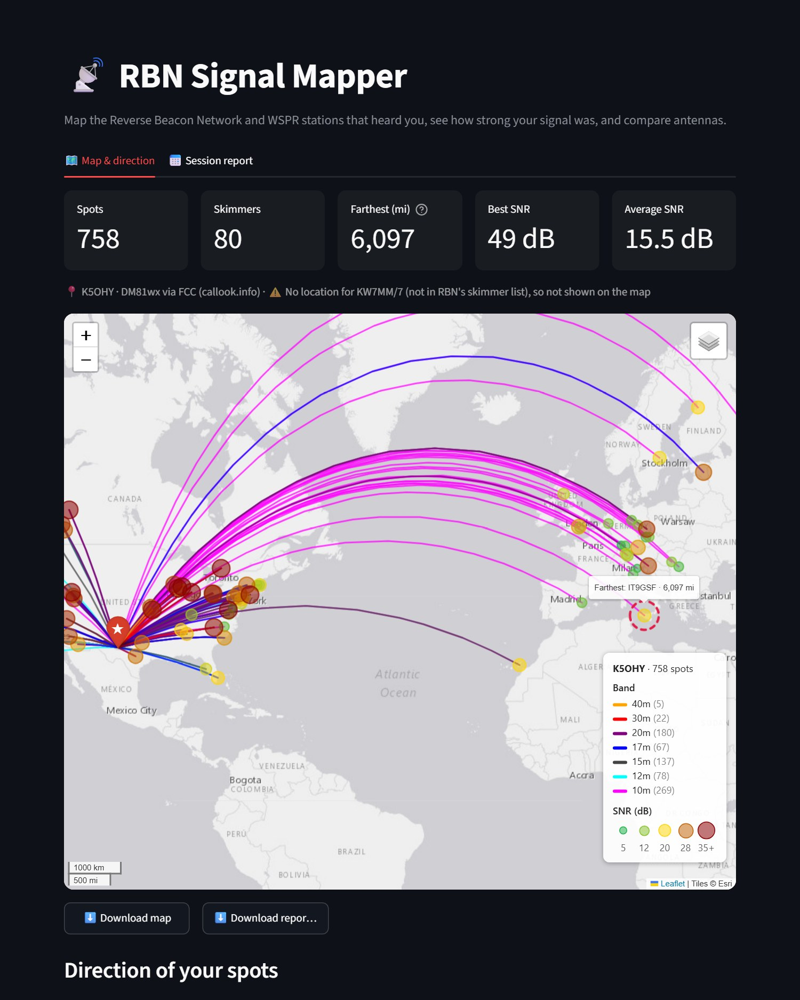
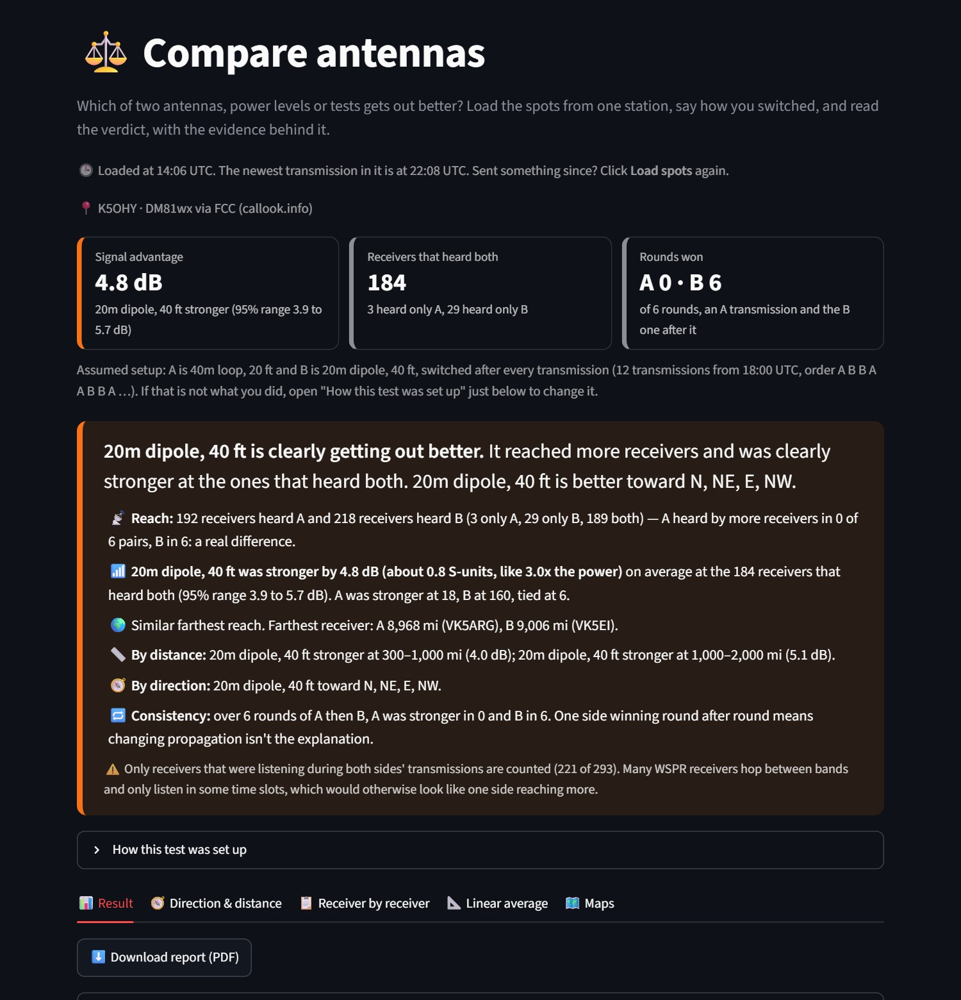
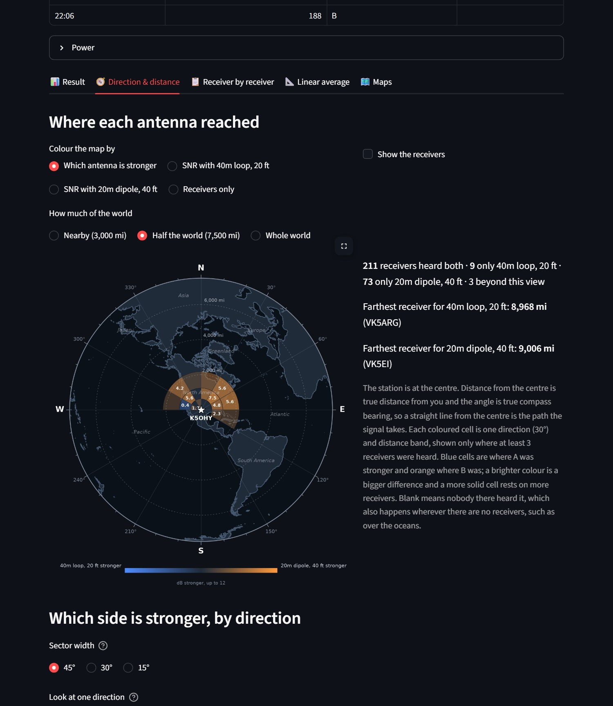
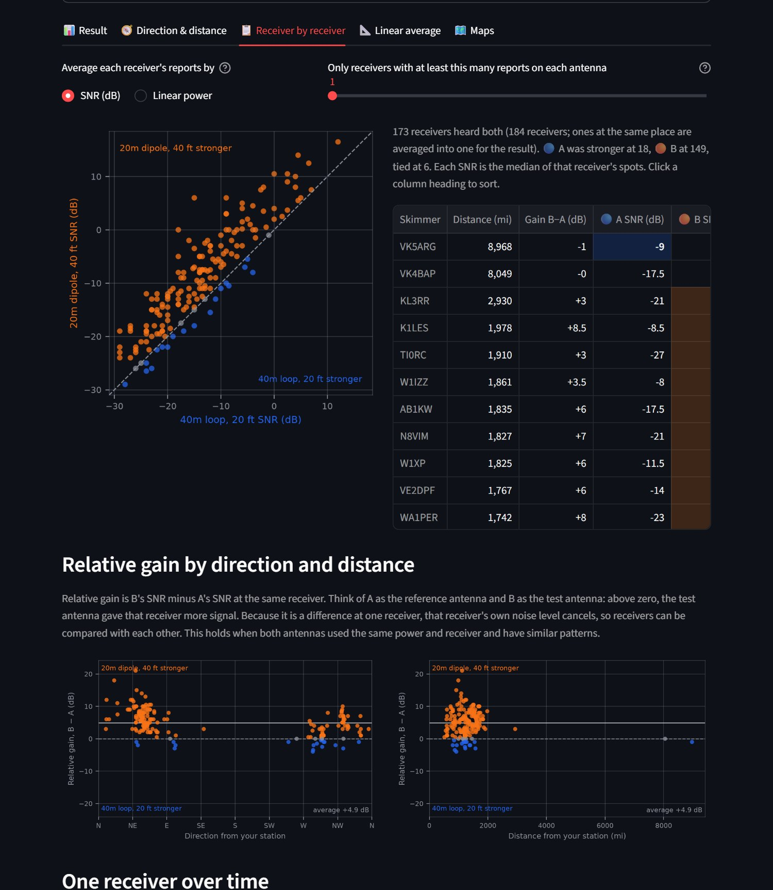
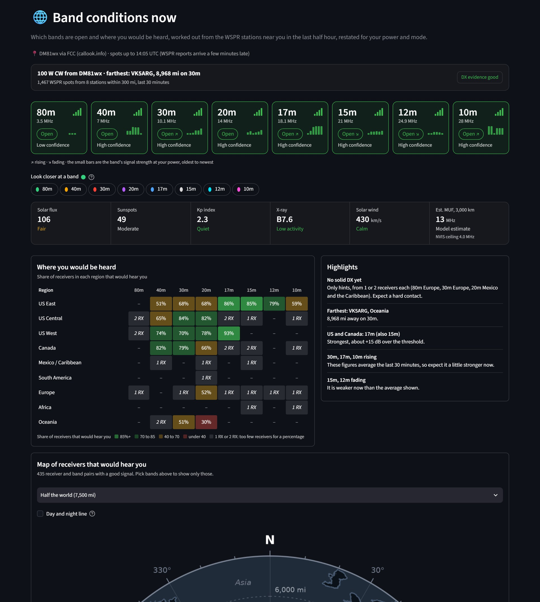

# RBN Signal Mapper

See where your signal is heard, how strong it is, and how conditions change. Map the [Reverse Beacon Network](https://www.reversebeacon.net/) stations that spotted your CQ, or the [WSPR](https://wsprnet.org/) stations that heard your beacon. Compare which of two antennas, frequencies or power levels is getting out better, using real-world signal measurements. And check which bands are open and where you would be heard right now.

**Jump to:** [Quick start](#quick-start) · [The map](#the-map) · [Compare two antennas](#compare-two-antennas) · [Band conditions](#band-conditions-now) · [Run it locally](#run-it-locally) · [Troubleshooting](#troubleshooting)

**Try the beta online, nothing to install: [rbn-map-beta.streamlit.app](https://rbn-map-beta.streamlit.app/)** (the stable version is at [rbnmap.streamlit.app](https://rbnmap.streamlit.app/))

## What it looks like

**The map.** Every station that heard you, with the path to each one coloured by band and the dots coloured by signal strength. This is K5OHY's Reverse Beacon Network spots for 23 October 2025.



**Comparing two antennas.** The rest of these screens are from a real test: K5OHY's WSPR transmitter on 20m on 4 October 2026, 12 transmissions switched between a 40m loop at 20 ft (A) and a 20m dipole at 40 ft (B). The dipole won clearly.

**The verdict** comes first, in plain English: who reached more receivers, who was stronger and by how much, and whether changing conditions could explain it.



**Where each antenna reached.** A world map centred on the station, coloured by which antenna was stronger toward each direction and distance.



**Receiver by receiver.** Every station that heard both antennas, A's signal against B's, with a sortable table and the relative gain by direction and by distance.



**Band conditions.** Which bands are open now, worked out from the WSPR stations near you in the last hour.



## Quick start

1. Open the site (or [run it locally](#run-it-locally)).
2. Type your **callsign** in the sidebar.
3. Pick where the spots come from, then click **Load spots**.
4. Use the filters in the sidebar, and download the map or a PDF report if you want to share it.

The hosted site does not remember your settings; a local copy does (in `settings.json`). Free hosting can fall asleep: click the button to wake it.

## Getting your spots

**RBN: Download by date.** Pick a day or a range (up to 7 days). Works for anything up to yesterday (UTC), because RBN publishes a day's file after that day ends. Only spots of your callsign are kept.

**RBN: Paste from RBN site.** For spots from the last few minutes or hours, and for quick tests. Look up your callsign on [reversebeacon.net](https://www.reversebeacon.net/), copy the spot rows, paste them into the box, and click Load spots. The app reads each field by what it looks like, so odd spacing is fine.

**WSPR.** Pick a date (today works) and click Load spots. The app looks up WSPR spots sent by the callsign you entered, so use the callsign your WSPR transmitter sends. Reports take about 5 minutes to arrive in full; a newer cycle is still used and marked *may be incomplete*. Click Load spots again to refresh.

WSPR differs from RBN in a few ways: SNR is mostly negative (about -30 to +5 dB), the stations are called receivers, and *Show all skimmers* is off because there is no list of every WSPR receiver.

## The map

- Paths from you to every station that heard you, drawn as great circles and coloured by band.
- Dots sized and coloured by SNR. Click one for every spot from that station. The farthest station is circled.
- Filters: **Band**, **UTC time window** (one-minute steps), and **Minimum SNR** (RBN). They update the map instantly.
- With Compare mode off, a **Session report** tab for the whole day, across every band you loaded: when you were heard on each band, a band-by-hour grid (spots, farthest reach or median signal), a band scorecard, and how many stations heard you on each band by region (US East/Central/West, Canada, Europe, Asia and so on). It counts time you were *heard*, not time on the air, because a spot only exists when someone heard you.
- With Compare mode off, a **World view from your station** below the map: the same azimuthal map, coloured by average SNR or by how many stations heard you in each direction and distance cell.
- Stats above the map, a compass chart of your spots by direction below it, and a sortable spot table.
- Map style (light, dark, satellite, street), miles or kilometres, and **Download map** (a standalone HTML file).
- **Download report (PDF)** next to it: key numbers, the session report, direction chart and the stations that heard you.

Your location comes from the grid you typed, else the RBN skimmer list, else the FCC ([callook.info](https://callook.info)), else [HamDB](https://hamdb.org), else the centre of your country (the app warns you). Enter a grid for an exact pin.

## Compare two antennas

Tick **Compare two antennas or tests**. Name your antennas under *Name your antennas* if you like.

### With WSPR (the best way to test antennas)

A WSPR transmission lasts about 110 seconds of each 2-minute slot, so there is a short break between transmissions. Flip the antenna switch in that break.

1. Connect the transmitter to an A/B coax switch with one antenna on each output. Use one band, one power and one callsign for the whole test.
2. Let the transmitter send in every slot. If it can send an extra packet between cycles (for example a 6-character locator option), turn that off.
3. Wait for the transmission to end, flip the switch, and let the next one start. Go **A, B, A, B** or **A, B, B, A**, always starting on A. Note the time of the first transmission.
4. Run at least 8 transmissions (4 pairs, about 16 minutes). Eight is a first look at signal strength. It is too few to tell which antenna reached more receivers, because that needs at least 6 pairs where one antenna clearly reached more (pairs that tie don't count), so plan on 12 to 16 transmissions or more for small differences or a reach verdict.
5. Wait about 5 minutes, pick the date, and click Load spots.
6. Under **Your test**, set **Transmissions in your test** (every 2-minute cycle on either antenna counts: A then B is 2), and **Starting at** if it was not the latest test. It shows how small a difference that many pairs can reliably show. Check the **Order** and the Antenna column match your notes, and read the result. Fix any row, or clear it to leave it out.

**Long tests.** For a long, time-averaged test (one antenna for 30 minutes or an hour, then the other, over several hours), choose **In long blocks** under *Your test*, then give the start time, minutes per block and number of blocks. Every transmission in a block counts for that block's antenna, and each receiver's reports on A and on B are compared as a whole. Aim for 20 or more reports per receiver on each antenna. Shorter blocks of 10 or 20 minutes can work as well: what matters is running enough blocks to get at least 20 reports per antenna at each of enough receivers to see the big picture, and propagation decides how long that takes. You can keep clicking **Load spots** while you collect and watch the **Data used** box (the count of receivers with 20 or more reports on each antenna) to see when enough is enough. The start time can be typed (12:30 or 1230), even if nothing was heard at that minute. The From of each block can be edited in the table (each block ends when the next one starts, so that is all you need; untick the box to set the To times yourself), and for uneven blocks you can paste a schedule, one block per line like `16:40-17:12 A`. A test that runs past midnight UTC needs **Date range** under Period, with To set to the next day; the page says so if the blocks run past the spots loaded.

Use an even number of transmissions: an odd one has no partner and is left out.

### With RBN

Call CQ with the first antenna on one frequency, then with the other antenna on a nearby frequency, back to back (a minute or two apart). Paste the spots and click Load spots. The two biggest frequency groups become A and B; change them with the dropdowns. Skimmers report slightly different frequencies for the same signal, so spots closer than 0.5 kHz count as one (it looks closer if your two tests are nearer than that). RBN is compared by frequency only, because skimmers report a spot a minute or more after you send, which is too blurry to separate A and B by the clock.

Send plenty of CQs on each side, at the same power and speed (or enter the power under **Power**).

### Reading the result

- **Result.** The verdict first, in plain English, with the evidence and any caveats. Then a scoreboard, who heard you on each side, and a timeline of every spot in the order it happened. **Download report (PDF)** sits under the verdict. A collapsed **Data used** box says how many spots and receivers went in (loaded, in the test, compared, and how many have 5, 20 and 40 or more reports on each antenna) and what was left out and why; it is in the PDF too.
- **Direction & distance.** A world map centred on your station (distance from the centre is true distance, angle is true compass bearing), coloured by direction and distance: which antenna is stronger, or the SNR with A or B, or just the receivers (filled where both antennas were heard, open where only one was), so you can see whether an antenna is getting out toward Europe, Asia or Oceania; zoom between nearby, half the world and the whole world. Then a rose chart of how much stronger one side is toward each direction (longer bar means a bigger difference; blue A, orange B; fainter or hatched for fewer receivers; pick 45, 30 or 15 degree sectors, or one direction to see its numbers), the average SNR by direction, and the same by distance range.
- **Receiver by receiver.** Every station that heard both sides, as a chart and a table. The table gives each station's **relative gain** (B's SNR minus A's, so A is the reference and B the test), and two charts plot that gain against direction and against distance. You choose how each station's reports are averaged (SNR in dB, or linear power) and the minimum number of reports a station needs on each antenna, so you can watch the answer settle as the weak, thin stations drop out. Pick one station (sorted A to Z, by distance, by direction or by reports) to see every report from it against time for both antennas, with each antenna's average, the relative gain and its 95% range, which shows fading and band changes at a glance. Under the relative gain charts, a **summary table** gives the average gain by direction (eight octants or four quadrants) and by distance (Short, Medium and Long, with cut points you can change), with the number of receivers and a 95% range for each; it is in the PDF too. For a long-block test, a **Relative gain over time** view averages the gain in windows that are a few block lengths long (20 minutes with 10 minute blocks, 40 with 20 minute blocks) (all stations, with a 95% range, plus the picked station), so a band opening during the test shows up instead of being averaged away. The difference cancels each station's own noise level, so stations can be compared with each other.
- **Linear average.** The standard SNR average next to the same comparison done by averaging power instead of dB (each report turned into power, averaged per antenna, turned back into dB), overall and by direction, with when to use which.
- **Maps.** A's map and B's map side by side.

Differences are always shown as who is ahead and by how much (for example *B +2.0 dB*), never as a negative number.

### How the comparison works

The idea is simple: ask the same receivers about both antennas, so everything that stays the same for both antennas drops out. A receiver in Germany has its own noise level and its own path to you, and those stable effects are the same for A and B. Conditions that change over time are not the same, which is why the antennas are alternated and why a result is worth repeating on another day. Subtract the receiver's report for A from its report for B and what is left is the difference between the antennas at that receiver. That is the **relative gain** (B minus A, in dB, so A is the reference and B the test; the program works with A minus B internally and shows who is ahead and by how much). Do it for every receiver that heard both and average the results, and you have one number for how much better or worse B is than A, with a 95% range showing how uncertain that number is. WSPR reports move dB for dB with your power as a good approximation, so a difference in transmit power is simply added or subtracted first.

Only receivers that heard both antennas count, only receivers with evidence of listening during both antennas' transmissions (they decoded other stations in those slots), and receivers at the same place are counted once, because they see the same sky and are not independent witnesses. The long-test method (relative gain at each receiver, linear-power averaging and long alternating blocks) comes from the work of [Dale, N3HXZ](https://www.n3hxz.net/), who compares antennas this way with WSPR. The quick paired test is this app's own.

The one real choice is how to combine a receiver's several reports on the same antenna. There are two ways:

- **dB, the default for quick tests.** Switch after every transmission. Each A transmission is paired with the B transmission next to it, a minute or two apart, and the dB difference is taken for each pair. A receiver's answer is the middle value of its differences. Because A and B are measured minutes apart, slow changes in the band mostly cancel, and a receiver that heard only a few pairs still counts. This is the right choice for a quick test of 8 to 16 transmissions.
- **Linear power, for long tests.** Run each antenna for a block of 30 minutes to an hour, alternating over several hours. Each report is turned from dB into a power ratio (10 to the power of dB divided by 10), all of a receiver's reports on A are averaged as power, the same for B, and the ratio of the two averages is turned back into dB. This is the arithmetic mean of the decoded signal-to-noise power ratios (it is not received power in watts), and it does not depend on any two particular transmissions matching. It needs many reports per receiver: this app aims for 20 or more on each antenna, and the published method keeps receivers with 40 or more. Alternating blocks help balance band changes (an opening, a fade) between the two antennas, but they can't guarantee it.

Why they can disagree: averaging in dB treats every report as equal (and the app uses the middle value of the dB reports), while averaging power lets the strong reports count for more. For example, reports of 0, 0, 0 and 20 dB have a middle value of 0 dB and a plain dB average of 5 dB, but as power they average to about 14 dB, because the one 20 dB report carries 100 times the power of each of the others. Neither is wrong: they answer different questions, the typical difference versus the difference in average power. More reports generally make the averages steadier, especially when both antennas are tested repeatedly under comparable conditions. Twenty to forty reports per antenna at each receiver is a useful target, but no fixed number guarantees a reliable result.

**A limit on weak signals.** WSPR decodes down to about -28 dB under good conditions. A signal weaker than that is never reported at all, so an average of the reports you do have is not an average of everything that was sent. The app can ignore reports near that floor as a check on how much they matter, but that does not correct for the missing ones. Compare how many receivers heard each antenna as well as how strong they were, especially when one antenna is much weaker.

On the **Linear average** tab, and in the table on **Receiver by receiver**, you can see both answers side by side and change the minimum number of reports a receiver needs. If the two agree within 1 dB, that is a useful consistency check, but not independent proof, because both use the same reports. If they disagree substantially, find out why before drawing a conclusion. For a short alternating test the paired dB method is generally preferable. For a longer, well-balanced test the linear-power method is another useful measure, though a few very strong reports can dominate it. Collect more data before believing a small difference.

#### The math, step by step

For each receiver we work out one number: how many dB better (or worse) antenna B did than antenna A at that receiver. We call it **G**, for gain. Then we combine the G values from all the receivers. If B was sent at a different power, its readings are first shifted by that many dB so the antennas are compared at equal power. G measures real-world performance along those paths, not absolute antenna gain. (Inside the program the subtraction is done the other way round, A minus B, and shown as who is ahead and by how much.)

A few words used below. A *reading* is one SNR report in dB. The *middle value* (the median) is what you get when you line the numbers up and pick the one in the middle, so one wild reading can't move it.

**Method 1: the dB way (quick tests)**

1. For each A, B pair of transmissions, subtract A's reading from B's.
2. Line up those differences and take the middle value. That is G.

*Example.* A receiver's five pairs give +4, +6, +5, +20 and +5 dB. Lined up they are 4, 5, 5, 6, 20, so the middle is **+5 dB**. The odd +20 doesn't distort the answer. For long blocks with no pairs, the middle of all B's readings minus the middle of all A's is used instead.

**Method 2: the power way (long tests)**

1. Turn each reading from dB into a power number: 0 dB is 1, 10 dB is 10, 20 dB is 100, and -10 dB is 0.1. (The rule is 10 to the power of dB divided by 10.)
2. Average A's power numbers, and average B's power numbers.
3. Divide B's average by A's average.
4. Turn the answer back into dB. That is G.

*Example.* A's readings are 0, 0, 0 and 20 dB, which are powers 1, 1, 1 and 100, averaging 25.75. B's are 5, 5, 5 and 5 dB, each 3.16, so B averages 3.16. Dividing gives 0.123, which is **-9.1 dB**. A's one loud report dominates, which is why this method needs many reports from each receiver. Even with many reports, it only averages successful decodes: signals too weak to decode are missing from the data (see the note on weak signals above).

**Combining the receivers**

1. Count receivers at the same place once, because they see the same sky and are not independent witnesses.
2. Add up the G values and divide by how many there are.

*Example.* Four receivers give +5, +3, +6 and +2 dB. The total is 16, and 16 divided by 4 is **+4 dB**, so B is about 4 dB better.

**How sure is that number?** The app also gives a 95% range. Suppose B comes out +4 dB stronger with a range of +3 to +5 dB: the whole range is above zero, which is good evidence that B is stronger. If the range ran from -1 to +9 dB, there is too much uncertainty to call a winner. (Strictly, a 95% range means that if you repeated the test many times, about 95 of every 100 ranges built this way would contain the true value, provided the method's assumptions hold.) A side is declared ahead only when the whole range is on its side of zero and the gap is at least 1 dB. A smaller gap is called no meaningful difference, which covers two cases: the whole range sits inside 1 dB, or a lead is probably real but under 1 dB. Neither proves the antennas are identical, and a short test can still be fooled by changing propagation.

<details>
<summary><b>For the math-minded: the formulas</b></summary>

**Symbols.** For one receiver, $a_1 \dots a_m$ are its readings on antenna A and $b_1 \dots b_n$ its readings on antenna B, all in dB. $G$ is the relative gain, B minus A. $N$ is the number of independent sites, and $\Sigma$ means "add up".

**dB method (quick tests).** Each B transmission is paired with the A transmission next to it, round $k$, and the receiver's answer is the middle value of those pair differences:

$$G = \mathrm{median}_k \left( b_k - a_k \right)$$

When blocks are long and there are no pairs, the same idea is used on the whole set: $G = \mathrm{median}(b) - \mathrm{median}(a)$.

**Linear power method (long tests).** Each report is turned into a power ratio, a power average is taken for each antenna, and the ratio is turned back into dB:

$$G = 10 \log_{10} \frac{\frac{1}{n} \sum_{j=1}^{n} 10^{b_j/10}}{\frac{1}{m} \sum_{i=1}^{m} 10^{a_i/10}}$$

Because WSPR reports move dB for dB with transmit power, $G$ is the relative signal-strength advantage of antenna B over A at that receiver, however strong or weak that receiver is.

**Combining sites.** Receivers at the same place are merged into one, leaving $N$ independent sites with gains $G_1 \dots G_N$. The headline number is their mean, each site counting equally:

$$\bar{G} = \frac{1}{N} \sum_{r=1}^{N} G_r$$

**The 95% range** says how uncertain that average is, and the app uses a few methods depending on the test. For the standard comparison it resamples the sites (a bootstrap). For an alternating test it also widens that range when needed to allow for fading from one pair of transmissions to the next, which moves every receiver together. For short unpaired tests and for the linear-power check it uses the Student t interval, $\bar{G} \pm t_{0.975,N-1} s/\sqrt{N}$, where $s$ is the standard deviation of the $G_r$ and $t$ is the Student t critical value for $N-1$ degrees of freedom. A range is not a guarantee that the true difference lies inside it.

</details>

### How the verdict is decided

- **Strength.** Only stations that heard both sides count, so each station is its own control. Each station's difference is averaged, with a 95% range. A side wins if the whole range favours it and the gap is at least 1 dB. A smaller gap is called *no meaningful difference*, meaning either that the range sits inside 1 dB or that a lead is real but too small to matter; it does not prove the antennas are identical.
- **Reach.** How many different stations heard each side. For WSPR it is judged one pair of transmissions at a time, because fading on your end moves every receiver together. It needs at least 6 decisive pairs, ones where one antenna reached more stations (ties don't count), so a short test often can't call it.
- **Too close to call** means the data aren't strong enough to separate the antennas. One may look ahead, but ordinary variation could explain the gap, and the verdict says how often a lead that size, in that direction, would still appear if the two truly reached equally (for example about 12% of the time). That is not the same as the antennas being equal, and it is not the probability that one is better. For RBN it also says how much more data would settle it.
- **Direction and distance** are only called when at least 4 stations heard both sides there, the gap is at least 2 dB, and a stricter 99% range agrees. With this many sectors checked at once, treat a direction result as a lead to follow up, not a finding.
- **Two ways of averaging.** The dB average and the linear (power) average are explained under *How the comparison works*, above. The **Linear average** tab shows both so you can check that they agree.
- **Fairness.** For WSPR only receivers with evidence of listening during both sides' transmissions count, and cycles heard by 2 or fewer receivers are ignored when normal cycles are heard by many more (usually one receiver with a wrong clock). A cycle with no partner on the other antenna is left out. Power differences are corrected (WSPR carries the power). Skimmers at the same place are counted once. If A and B were sent more than about 10 minutes apart, the verdict warns that the time of day could explain the difference.

## Band conditions now

The **Band conditions** page (in the sidebar menu) tells you which bands are open and where a signal like yours would be heard, which helps when you are deciding whether to change band at a park. It takes the WSPR stations transmitting near you (your grid square or callsign, within an area you choose) over the last hour, and restates each report for **your power and mode**: SNR moves dB for dB with power, and each mode needs a minimum SNR, so the gap is your margin.

- **Learn from** stations near you, or from **one transmitter**: your own WSPR transmitter, or a friend's. A transmitter at your own location with your own antenna is the closest match to how you will be heard (on 16 Oct every one of K5OHY's 72 contacts fell in a band and region it rated 80% or better, against a median of 61% using nearby stations), though it only shows what that one station was doing. That was a first check on one station on one day, not a calibration.
- A band-by-band table: open, marginal or quiet, whether it is opening or fading, how many receivers would hear you, and the farthest one.
- A region table (US East, Europe, South America and so on) showing the **chance a receiver there hears you** (with how many receivers it rests on), your margin, or the **power you would need** to reach a typical receiver there. The chance allows for the typical error of about 8 dB measured against RBN readings, and a region heard by only one or two receivers is shown greyed as a hint, since in a week of checking, regions like that were really spotted only about 4 times in 10.
- The farthest receivers that would hear you, and a map of them.

**About the percentages.** They are estimates worked out from WSPR reports, your power, the mode thresholds and an assumed error of about 8 dB. They are good for comparing bands and directions, but they are not measured success rates: what you actually hear also depends on your antenna, the receiver's noise and the conditions.

It is a guide good to a few dB, not a promise: it only counts receivers that heard the nearby WSPR stations (so with more power than they used you would be heard in more places), WSPR receivers are often quiet sites, and the mode thresholds are approximate. There is a box for how your antenna compares with theirs. **CW** is the strength a hunter needs to copy you; **CW spot** is the strength an RBN skimmer needs to report you (which is what gets you onto the spotting sites), about 3 dB lower. The CW spot figure was set by comparing two stations' CW activations on RBN with their own co-located WSPR transmitters (RBN readings ran about 11 dB above the WSPR-based figure: 12.5 dB for an OCF dipole at 75 W and 9 dB for a quarter-wave vertical at 100 W, with a spread of 7 to 9 dB), so treat it as a guide from a small sample. Find yourself by callsign, by grid square (a park, say), or with a **Use my location** button that asks your browser for your position; the area around you can be set in miles or kilometres.

## Run it locally

You need [Python 3.9+](https://www.python.org/downloads/). These steps install the stable version; the beta is at [github.com/K5OHY/RBN-Map-Beta](https://github.com/K5OHY/RBN-Map-Beta).

**Windows (PowerShell).** Set it up once:

```bash
git clone https://github.com/K5OHY/RBN_Map.git
cd RBN_Map
python -m venv .venv
.venv\Scripts\python -m pip install -r requirements.txt
```

Then start it from the project folder:

```bash
.venv\Scripts\streamlit run web.py
```

Use exactly that command. Plain `streamlit run web.py` fails with "not recognized" because the packages live inside `.venv`. If `python` is not found, try `py -m venv .venv`.

**macOS / Linux.**

```bash
git clone https://github.com/K5OHY/RBN_Map.git
cd RBN_Map
python3 -m venv .venv
.venv/bin/python -m pip install -r requirements.txt
.venv/bin/streamlit run web.py
```

Next time, just run the last command again. Open http://localhost:8501 if the browser does not open, and stop the app with Ctrl+C (close the browser tab first if it hangs).

The skimmer list refreshes itself every 24 hours. To force it: `.venv\Scripts\python rbn_to_csv.py` (macOS/Linux: `.venv/bin/python rbn_to_csv.py`).

## Help inside the app

The **Help and README** page in the app shows this README, so the instructions are always at hand. The sidebar has a link to the README and code on GitHub.

## Troubleshooting

| What you see | What to do |
| --- | --- |
| "RBN has no data file for ... yet" | RBN publishes a day's file after the UTC day ends. Pick an earlier date, or paste today's spots. |
| "RBN has no spots of ... for that date" | Check the callsign or try another day. |
| "Couldn't read any spot rows" | Copy the rows straight from the RBN spot table. The message quotes the first line it couldn't read. |
| "Couldn't find a location for ..." | Enter your grid square in the sidebar. |
| "No location for ..." under the stats | Those skimmers are not in RBN's node list, so they are counted but not drawn. |
| Compare found only one frequency group | Your spots are on one frequency, or your two tests were less than 0.1 kHz apart. Use a different frequency for each antenna. |
| A few WSPR cycles show only one or two receivers while the rest show dozens | Usually one receiver with a wrong clock. The app ignores them and says how many. |
| "Not enough data yet" / too close to call | Run more transmissions per antenna (see above). |
| Downloading is slow | A day of RBN data is a large file. Each day in a range is a separate download. Results are cached for an hour. |

## Files

| File | Purpose |
| --- | --- |
| `web.py` | The Streamlit app |
| `compare_stats.py` | The A/B maths and the plain-English verdict |
| `report_pdf.py` | Lays out the PDF reports |
| `rbn_data.py` | Skimmer list, callsign location lookup, grid conversion |
| `wspr_data.py` | Fetches WSPR spots |
| `world_map.py` | Draws the world map centred on your station |
| `session_report.py` | Builds the session report: timeline, band-by-hour grid, scorecard and regions |
| `conditions.py` | Band conditions: nearby WSPR stations restated for your power and mode |
| `world_land.npz`, `build_world_mask.py` | The land/ocean grid the map is drawn from, and the one-off script that built it |
| `spotter_coords.csv` | Cached skimmer locations (updated automatically) |
| `cty.dat` | Country prefixes from [country-files.com](https://www.country-files.com), for the approximate-location fallback |
| `rbn_to_csv.py` | Refreshes the skimmer list now |
| `Update_spotters.py` | Older helper, not needed |
| `requirements.txt` | Python packages |
| `settings.json` | Your saved settings (local, never committed) |

## Data sources and thanks

Thanks to **Dale, N3HXZ** ([n3hxz.net](https://www.n3hxz.net/)) for the long-test method (relative gain, linear-power averaging and long alternating blocks) behind the Linear average and Relative gain views, and for his testing and feedback.

[Natural Earth](https://www.naturalearthdata.com/) (public domain world outlines for the map), [Reverse Beacon Network](https://www.reversebeacon.net/), [wspr.live](https://wspr.live/) and [WSPRnet](https://wsprnet.org/), [callook.info](https://callook.info), [HamDB](https://hamdb.org), [country-files.com](https://www.country-files.com), Esri and OpenStreetMap map tiles. Built with [Streamlit](https://streamlit.io/), [Folium](https://python-visualization.github.io/folium/), [pandas](https://pandas.pydata.org/), [Matplotlib](https://matplotlib.org/) and [GeographicLib](https://geographiclib.sourceforge.io/).

## License

MIT License.
