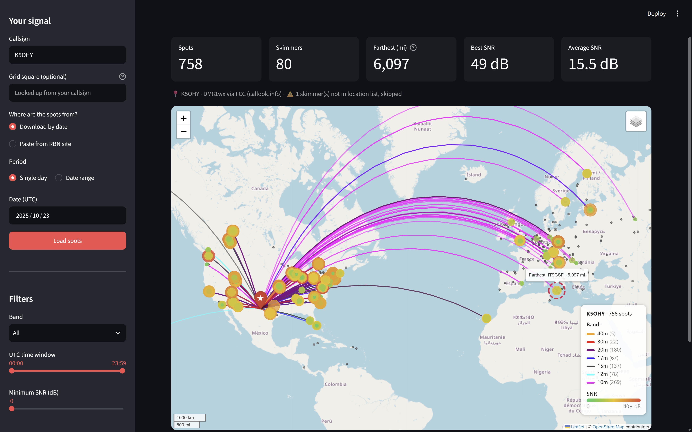

# RBN Signal Mapper

See who heard you, how strong, and from where. Map the [Reverse Beacon Network](https://www.reversebeacon.net/) stations that spotted your CQ, or the [WSPR](https://wsprnet.org/) stations that heard your beacon. Compare mode tells you which of two antennas, frequencies or power levels is getting out better.

**Try the beta online, nothing to install: [rbn-map-beta.streamlit.app](https://rbn-map-beta.streamlit.app/)** (the stable version is at [rbnmap.streamlit.app](https://rbnmap.streamlit.app/))



## Quick start

1. Open the site (or [run it locally](#run-it-locally)).
2. Type your **callsign** in the sidebar.
3. Pick where the spots come from, then click **Load spots**.
4. Use the filters in the sidebar, and download the map or a PDF report if you want to share it.

The hosted site does not remember your settings; a local copy does (in `settings.json`). Free hosting can fall asleep: click the button to wake it.

## Getting your spots

**RBN: Download by date.** Pick a day or a range (up to 7 days). Works for anything up to yesterday (UTC), because RBN publishes a day's file after that day ends. Only spots of your callsign are kept.

**RBN: Paste from RBN site.** For spots from the last few minutes or hours, and for quick tests. Look up your callsign on [reversebeacon.net](https://www.reversebeacon.net/), copy the spot rows, paste them into the box, and click Load spots. The app reads each field by what it looks like, so odd spacing is fine.

**WSPR.** Pick a date (today works) and click Load spots. The app looks up WSPR spots sent by the callsign you entered, so use the callsign your WSPR transmitter sends. Reports take about 5 minutes to arrive in full; a newer cycle is still used and marked *may be incomplete*. Click Load spots again to refresh.

WSPR differs from RBN in a few ways: SNR is mostly negative (about -30 to +5 dB), the stations are called receivers, and *Show all skimmers* is off because there is no list of every WSPR receiver.

## The map

- Paths from you to every station that heard you, drawn as great circles and coloured by band.
- Dots sized and coloured by SNR. Click one for every spot from that station. The farthest station is circled.
- Filters: **Band**, **UTC time window** (one-minute steps), and **Minimum SNR** (RBN). They update the map instantly.
- With Compare mode off, a **Session report** tab for the whole day, across every band you loaded: when you were heard on each band, a band-by-hour grid (spots, farthest reach or median signal), a band scorecard, and how many stations heard you on each band by region (US East/Central/West, Canada, Europe, Asia and so on). It counts time you were *heard*, not time on the air, because a spot only exists when someone heard you.
- With Compare mode off, a **World view from your station** below the map: the same azimuthal map, coloured by average SNR or by how many stations heard you in each direction and distance cell.
- Stats above the map, a compass chart of your spots by direction below it, and a sortable spot table.
- Map style (light, dark, satellite, street), miles or kilometres, and **Download map** (a standalone HTML file).
- **Download report (PDF)** next to it: key numbers, the session report, direction chart and the stations that heard you.

Your location comes from the grid you typed, else the RBN skimmer list, else the FCC ([callook.info](https://callook.info)), else [HamDB](https://hamdb.org), else the centre of your country (the app warns you). Enter a grid for an exact pin.

## Compare two antennas

Tick **Compare two antennas or tests**. Name your antennas under *Name your antennas* if you like.

### With WSPR (best for antennas)

A WSPR transmission lasts about 110 seconds of each 2-minute slot, so there is a short break between transmissions. Flip the antenna switch in that break.

1. Connect the transmitter to an A/B coax switch with one antenna on each output. Use one band, one power and one callsign for the whole test.
2. Let the transmitter send in every slot. If it can send an extra packet between cycles (for example a 6-character locator option), turn that off.
3. Wait for the transmission to end, flip the switch, and let the next one start. Go **A, B, A, B** or **A, B, B, A**, always starting on A. Note the time of the first transmission.
4. Run at least 8 transmissions (4 pairs, about 16 minutes). Fewer is a quick check; 12 to 16 is better for small differences.
5. Wait about 5 minutes, pick the date, and click Load spots.
6. Under **Your test**, set **Transmissions in your test** (every 2-minute cycle on either antenna counts: A then B is 2), and **Starting at** if it was not the latest test. It shows how small a difference that many pairs can reliably show. Check the **Order** and the Antenna column match your notes, and read the result. Fix any row, or clear it to leave it out.

**Long tests.** For a long, time-averaged test (one antenna for 30 minutes or an hour, then the other, over several hours), choose **In long blocks** under *Your test*, then give the start time, minutes per block and number of blocks. Every transmission in a block counts for that block's antenna, and each receiver's reports on A and on B are compared as a whole. Aim for 20 or more reports per receiver on each antenna.

Use an even number of transmissions: an odd one has no partner and is left out.

### With RBN

Call CQ with the first antenna on one frequency, then with the other antenna on a nearby frequency, back to back (a minute or two apart). Paste the spots and click Load spots. The two biggest frequency groups become A and B; change them with the dropdowns. Skimmers report slightly different frequencies for the same signal, so spots closer than 0.5 kHz count as one (it looks closer if your two tests are nearer than that). RBN is compared by frequency only, because skimmers report a spot a minute or more after you send, which is too blurry to separate A and B by the clock.

Send plenty of CQs on each side, at the same power and speed (or enter the power under **Power**).

### Reading the result

- **Result.** The verdict first, in plain English, with the evidence and any caveats. Then a scoreboard, who heard you on each side, and a timeline of every spot in the order it happened. **Download report (PDF)** sits under the verdict.
- **Direction & distance.** A world map centred on your station (distance from the centre is true distance, angle is true compass bearing), coloured by direction and distance: which antenna is stronger, or the SNR with A or B, or just the receivers (filled where both antennas were heard, open where only one was), so you can see whether an antenna is getting out toward Europe, Asia or Oceania; zoom between nearby, half the world and the whole world. Then a rose chart of how much stronger one side is toward each direction (longer bar means a bigger difference; blue A, orange B; fainter or hatched for fewer receivers; pick 45, 30 or 15 degree sectors, or one direction to see its numbers), the average SNR by direction, and the same by distance range.
- **Receiver by receiver.** Every station that heard both sides, as a chart and a table. The table gives each station's **relative gain** (B's SNR minus A's, so A is the reference and B the test), and two charts plot that gain against direction and against distance. You choose how each station's reports are averaged (SNR in dB, or linear power) and the minimum number of reports a station needs on each antenna, so you can watch the answer settle as the weak, thin stations drop out. Pick one station to see every report from it against time for both antennas, with each antenna's average, the relative gain and its 95% range, which shows fading and band changes at a glance. For a long-block test, a **Relative gain over time** view averages the gain in windows of a few hours (all stations, with a 95% range, plus the picked station), so a band opening during the test shows up instead of being averaged away. The difference cancels each station's own noise level, so stations can be compared with each other.
- **Linear average.** The standard SNR average next to the same comparison done by averaging power instead of dB (each report turned into power, averaged per antenna, turned back into dB), overall and by direction, with when to use which.
- **Maps.** A's map and B's map side by side.

Differences are always shown as who is ahead and by how much (for example *B +2.0 dB*), never as a negative number.

### How the verdict is decided

- **Strength.** Only stations that heard both sides count, so each station is its own control. Each station's difference is averaged, with a 95% range. A side wins if the whole range favours it and the gap is at least 1 dB; a smaller gap is *equal*.
- **Reach.** How many different stations heard each side. For WSPR it is judged one pair of transmissions at a time, because fading on your end moves every receiver together. Fewer than 6 pairs can't be called.
- **Too close to call** means the data can't separate them; it is not the same as equal. If one side leads, the verdict gives the chance it really is ahead (for example about 88%), and for RBN how much more data would settle it.
- **Direction and distance** are only called when at least 4 stations heard both sides there, the gap is at least 2 dB, and a stricter 99% range agrees.
- **Two ways of averaging.** The default takes the dB difference at each receiver, a power ratio, and finds the typical difference. That works for short tests because A and B are measured minutes apart, but it adds up dB, and it depends on conditions being similar in neighbouring transmissions. The **Linear average** tab averages power instead: every report is turned from dB into power, each antenna's reports are averaged, and the ratio is turned back into dB. That is a true power average and doesn't rely on two particular transmissions matching, but it needs many reports per receiver (20 to 40, so hours of data), it is swung by a few strong reports (0, 0, 0 and 20 dB average to 14 dB, not 5), and it is thrown off by reports at WSPR's -28 dB decoding floor. For a short switched test, trust the default; for a long, time-averaged run, the power average; and if the two agree within 1 dB you can be more confident.
- **Fairness.** For WSPR only receivers that were listening during both sides' transmissions count, and cycles heard by 2 or fewer receivers are ignored when normal cycles are heard by many more (usually one receiver with a wrong clock). A cycle with no partner on the other antenna is left out. Power differences are corrected (WSPR carries the power). Skimmers at the same place are counted once. If A and B were sent more than about 10 minutes apart, the verdict warns that the time of day could explain the difference.

## Band conditions now

The **Band conditions** page (in the sidebar menu) tells you which bands are open and where a signal like yours would be heard, which helps when you are deciding whether to change band at a park. It takes the WSPR stations transmitting near you (your grid square or callsign, within an area you choose) over the last hour, and restates each report for **your power and mode**: SNR moves dB for dB with power, and each mode needs a minimum SNR, so the gap is your margin.

- **Learn from** stations near you, or from **one transmitter**: your own WSPR transmitter, or a friend's. A transmitter at your own location with your own antenna is the closest match to how you will be heard (on 16 Oct every one of K5OHY's 72 contacts fell in a band and region it rated 80% or better, against a median of 61% using nearby stations), though it only shows what that one station was doing.
- A band-by-band table: open, marginal or quiet, whether it is opening or fading, how many receivers would hear you, and the farthest one.
- A region table (US East, Europe, South America and so on) showing the **chance a receiver there hears you** (with how many receivers it rests on), your margin, or the **power you would need** to reach a typical receiver there. The chance allows for the typical error of about 8 dB measured against RBN readings, and a region heard by only one or two receivers is shown greyed as a hint, since in a week of checking, regions like that were really spotted only about 4 times in 10.
- The farthest receivers that would hear you, and a map of them.

It is a guide good to a few dB, not a promise: it only counts receivers that heard the nearby WSPR stations (so with more power than they used you would be heard in more places), WSPR receivers are often quiet sites, and the mode thresholds are approximate. There is a box for how your antenna compares with theirs. **CW** is the strength a hunter needs to copy you; **CW spot** is the strength an RBN skimmer needs to report you (which is what gets you onto the spotting sites), about 3 dB lower. The CW spot figure was set by comparing two stations' CW activations on RBN with their own co-located WSPR transmitters (RBN readings ran about 11 dB above the WSPR-based figure: 12.5 dB for an OCF dipole at 75 W and 9 dB for a quarter-wave vertical at 100 W, with a spread of 7 to 9 dB), so treat it as a guide from a small sample. Find yourself by callsign, by grid square (a park, say), or with a **Use my location** button that asks your browser for your position; the area around you can be set in miles or kilometres.

## Run it locally

You need [Python 3.9+](https://www.python.org/downloads/).

**Windows (PowerShell).** Set it up once:

```bash
git clone https://github.com/K5OHY/RBN_Map.git
cd RBN_Map
python -m venv .venv
.venv\Scripts\python -m pip install -r requirements.txt
```

Then start it from the project folder:

```bash
.venv\Scripts\streamlit run web.py
```

Use exactly that command. Plain `streamlit run web.py` fails with "not recognized" because the packages live inside `.venv`. If `python` is not found, try `py -m venv .venv`.

**macOS / Linux.**

```bash
git clone https://github.com/K5OHY/RBN_Map.git
cd RBN_Map
python3 -m venv .venv
.venv/bin/python -m pip install -r requirements.txt
.venv/bin/streamlit run web.py
```

Next time, just run the last command again. Open http://localhost:8501 if the browser does not open, and stop the app with Ctrl+C (close the browser tab first if it hangs).

The skimmer list refreshes itself every 24 hours. To force it: `.venv\Scripts\python rbn_to_csv.py` (macOS/Linux: `.venv/bin/python rbn_to_csv.py`).

## Troubleshooting

| What you see | What to do |
| --- | --- |
| "RBN has no data file for ... yet" | RBN publishes a day's file after the UTC day ends. Pick an earlier date, or paste today's spots. |
| "RBN has no spots of ... for that date" | Check the callsign or try another day. |
| "Couldn't read any spot rows" | Copy the rows straight from the RBN spot table. The message quotes the first line it couldn't read. |
| "Couldn't find a location for ..." | Enter your grid square in the sidebar. |
| "No location for ..." under the stats | Those skimmers are not in RBN's node list, so they are counted but not drawn. |
| Compare found only one frequency group | Your spots are on one frequency, or your two tests were less than 0.1 kHz apart. Use a different frequency for each antenna. |
| A few WSPR cycles show only one or two receivers while the rest show dozens | Usually one receiver with a wrong clock. The app ignores them and says how many. |
| "Not enough data yet" / too close to call | Run more transmissions per antenna (see above). |
| Downloading is slow | A day of RBN data is a large file. Each day in a range is a separate download. Results are cached for an hour. |

## Files

| File | Purpose |
| --- | --- |
| `web.py` | The Streamlit app |
| `compare_stats.py` | The A/B maths and the plain-English verdict |
| `report_pdf.py` | Lays out the PDF reports |
| `rbn_data.py` | Skimmer list, callsign location lookup, grid conversion |
| `wspr_data.py` | Fetches WSPR spots |
| `world_map.py` | Draws the world map centred on your station |
| `session_report.py` | Builds the session report: timeline, band-by-hour grid, scorecard and regions |
| `conditions.py` | Band conditions: nearby WSPR stations restated for your power and mode |
| `world_land.npz`, `build_world_mask.py` | The land/ocean grid the map is drawn from, and the one-off script that built it |
| `spotter_coords.csv` | Cached skimmer locations (updated automatically) |
| `cty.dat` | Country prefixes from [country-files.com](https://www.country-files.com), for the approximate-location fallback |
| `rbn_to_csv.py` | Refreshes the skimmer list now |
| `Update_spotters.py` | Older helper, not needed |
| `requirements.txt` | Python packages |
| `settings.json` | Your saved settings (local, never committed) |

## Data sources and thanks

Thanks to **Dale, N3HXZ** for the relative-gain method behind the Linear average and Relative gain views, and for his testing and feedback.

[Natural Earth](https://www.naturalearthdata.com/) (public domain world outlines for the map), [Reverse Beacon Network](https://www.reversebeacon.net/), [wspr.live](https://wspr.live/) and [WSPRnet](https://wsprnet.org/), [callook.info](https://callook.info), [HamDB](https://hamdb.org), [country-files.com](https://www.country-files.com), Esri and OpenStreetMap map tiles. Built with [Streamlit](https://streamlit.io/), [Folium](https://python-visualization.github.io/folium/), [pandas](https://pandas.pydata.org/), [Matplotlib](https://matplotlib.org/) and [GeographicLib](https://geographiclib.sourceforge.io/).

## License

MIT License.
